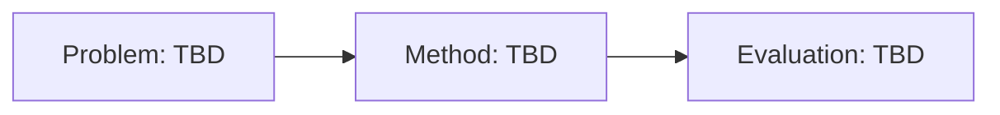

# STATUS

> Read at every session start. Rewritten by `/stage-summarizer` at session end. Keep under ~150 lines.
> Every claim here cites its source: a log date (`log/2026-11-05`), a decision (`D-001`), a hypothesis (`H-001`),
> a backlog item (`B-001`) or a results file (`experiments/results/<file>.json`).

**Last updated:** 2026-11-05 · **Stage:** idle (setup)

## Current idea

_No idea selected yet._ Finish setup (`docs/GUIDE.md` §0), fill in `RESEARCH_BRIEF.md`, then run `/idea-discovery "<direction>"`.

## Schematic

## Recent decisions

- `D-001` Repo set up on ARIS with state files, custom skills and the LaTeX workflow (log/2026-11-05).

## Open questions

- What is the research direction? (fill in `RESEARCH_BRIEF.md`)

## Next steps

- [ ] Finish setup: run the ARIS installer, python3 shim and wiki init (`docs/GUIDE.md` §0).
- [ ] Fill in `RESEARCH_BRIEF.md` (problem, background, constraints).
- [ ] Ingest 5–10 core papers into the wiki (`/research-lit "<topic>"` or `/research-wiki ingest`).
- [ ] Build the first related-work matrix (`/related-work-matrix`).
